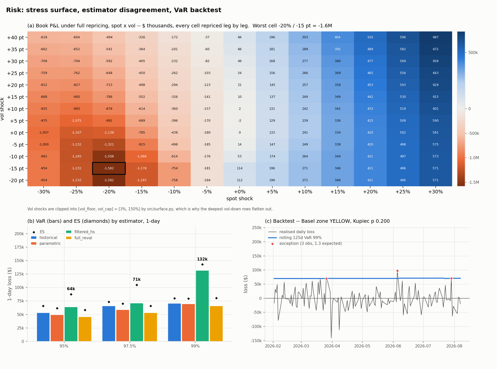

# Derivatives Pricing & Risk

**From market curves and volatility surfaces to portfolio valuation, Greeks, P&L attribution, and risk.**

## Overview

This repository builds an end-to-end derivatives valuation stack:

```text
market rates ------> SOFR curve -----------\
                                            > option pricing -> Greeks / P&L attribution -> portfolio risk
SPY option quotes -> SABR volatility surface /
```

It bootstraps a SOFR OIS curve from SR3 futures and OIS swaps, calibrates a SABR
surface to SPY implied volatilities, and uses the resulting market state to value
an eight-leg SPY option portfolio. The same leg-level pricing engine produces
portfolio Greeks, daily P&L attribution, full-revaluation VaR/ES, and stress
results. The curve and volatility modules produce calibrated market-state
inputs that converge in the portfolio valuation layer; attribution and risk then
reuse the same pricing machinery. The cached market snapshots make the reported
results reproducible.

## Pricing Framework

### 1. Curve construction

`curves/` builds a 40-year SOFR OIS curve from 7 SR3 futures and 14 OIS swaps.
The sequential bootstrap uses daily simple SOFR compounding on ACT/360,
Modified Following date adjustment, T+2 effective dates, and a two-business-day
payment lag. Its outputs include discount factors, zero rates, segment forwards,
par-rate checks, and bump-and-rebootstrap key-rate risk.

### 2. Volatility surface

`surface/` converts SPY option bid/ask mids to Black-76 implied volatilities and
calibrates Hagan SABR independently across eight expiries with beta fixed at
0.5. The cached snapshot holds ten expiries and
[`surface/tools/smile_roughness.py`](surface/tools/smile_roughness.py) re-derives
why two are left out: 2028-06-16 on quote quality (RMS implied-vol second
difference 0.4275 vol points, 5.9x the roughest expiry that is kept), and
2026-08-21 on scope rather than quality — it is the cleanest smile in the file,
but the downstream book's shortest leg reaches T = 0.114990y on the final
valuation date, exactly the first calibrated pillar, so a 14-day pillar is never
interpolated. Calibrating it anyway fits at 6.59 bp with every arbitrage check
still at zero. Forwards are inferred from put-call parity while discount factors are
pinned from the rate input. The calibrated surface is checked for butterfly and
calendar arbitrage before being passed downstream.


### 3. Option valuation and Greeks

`attribution/` maps the calibrated SABR term structure into a daily market
state and prices each European option leg with Black-Scholes. It calculates
standard and SABR-adjusted delta, gamma, vega, theta, rho, vanna, and volga.
Portfolio exposures are obtained by aggregating the eight priced legs; vega is
also measured by expiry bucket through bump-and-reprice.

### 4. Portfolio aggregation and repricing

The portfolio is valued leg by leg, then aggregated into book value and risk
sensitivities. The same portfolio pricer is reused by `risk/` as a revaluation
callback, so Greek approximations and full-repricing results are compared on a
consistent valuation basis.

## Key Results

| Stage | Verified result | Evidence |
|---|---|---|
| SOFR curve | **21 curve pillars** reproduce their input quotes to **4.91e-11 bp**, versus a **0.01 bp** tolerance | [`curves/output/par_rate_check.csv`](curves/output/par_rate_check.csv) |
| SABR surface | **735 SPY quotes across 8 expiries**; aggregate RMSE **24.4 bp** equal-weighted across expiries, **26.4 bp** quote-weighted | [`surface/output/calibrated_params.csv`](surface/output/calibrated_params.csv) |
| Surface fit disclosure | Excluding the 2.36y expiry, RMSE is **14.58 bp** equal-weighted and **14.79 bp** quote-weighted (619 quotes); that expiry fits poorly at **57.1 bp** and is retained rather than hidden | [`surface/README.md`](surface/README.md) |
| P&L attribution | Second-order Greeks reduce mean unexplained P&L from **$348 to $43** (**87.6%**), with **R² 0.99999** | [`attribution/output/attribution_summary.csv`](attribution/output/attribution_summary.csv) |
| Portfolio risk | 1-day 99% full-revaluation VaR **$65,588** and ES **$80,219** on a **$1.66M** book | [`risk/output/var_summary.csv`](risk/output/var_summary.csv) |
| Reproducibility | A clean clone re-running all four stages leaves `git status` clean: every committed output regenerates **byte for byte**, figures included | `make run` |

## Representative Portfolio Case

The central case is an eight-leg SPY option book containing calls and puts
across multiple strikes, expiries, and long/short positions. It connects every
stage of the repository:

1. Bootstrap discount factors and forward rates from the SOFR curve.
2. Calibrate the SPY SABR surface and assign each leg an implied volatility.
3. Price every leg and aggregate the portfolio value and Greeks.
4. Explain daily changes in book value with delta, gamma, vega, theta, rho,
   vanna, and volga.
5. Apply historical and hypothetical shocks through full leg-level repricing.
6. Aggregate the repriced loss distribution into VaR, ES, and stress results.

The 2026-08-07 snapshot has a portfolio value of **$1,662,294**. Its valuation,
exposures, attribution, and risk measures are therefore different views of the
same book rather than disconnected demonstrations.


## Pricing vs Approximation

The repository uses approximation as a benchmark against repricing, not as a
substitute for it.

- **First-order vs second-order attribution.** Adding gamma, vanna, and volga
  reduces mean unexplained daily P&L from $348 to $43, an 87.6% reduction.
- **Standard vs SABR delta.** Adding the smile response term to Black-Scholes
  delta reduces delta-hedged P&L volatility from **$5,454 to $3,311**, a 39.3%
  reduction.
- **Taylor vs full repricing at one-day shocks.** The delta-gamma-vega
  approximation stays within **6.0–10.4%** of full-revaluation VaR across the 95%,
  97.5% and 99% levels, measured as a fraction of the repriced number; `run_risk.py`
  prints the same three gaps against the parametric number instead (5.6–9.4%).
  Daily shocks are small enough for the local expansion to work well.
- **Taylor vs full repricing under stress.** Across eleven stress scenarios,
  the same expansion has a **32% median absolute error** and exceeds **100%** in two of them.
  The comparison locates the approximation's useful range: strong locally,
  materially less reliable at stress magnitudes.

## Risk & Validation

`risk/` treats the pricing engine as the foundation for downstream market-risk
analysis. It implements historical, parametric delta-gamma-vega, filtered
historical, and full-revaluation VaR/ES; historical and hypothetical stress
scenarios; a spot-vol grid; reverse stress; and Kupiec and Christoffersen
backtests.

The adverse results remain visible. Historical VaR fails the Kupiec test as
configured — 12 and 9 exceptions against 6.50 and 3.25 expected at 95% and 97.5%
— while Christoffersen finds no exception clustering, so the failure is one of
level rather than timing. Six tests are run across the three confidence levels,
so they are Holm-adjusted: the 97.5% rejection survives (p = 0.0077 → 0.0463) and
the 95% one does not (p = 0.0465 → 0.2325). The conclusion rests on the 97.5%
result and on the exception counts, which no adjustment touches.

Two things the backtest is not. The P&L series it tests is **model-generated** —
each day is this pipeline's own full revaluation of the book, not a traded result
— so it is a backtest of the model against itself. And the 2016 FRTB
variance-ratio test passes on all its variants, but risk-theoretical and hypothetical
P&L share the same surface, so that result is not an independent validation
either. Governance and SR 11-7-aligned documentation are kept in the
downstream validation report rather than used as the project's primary identity.



Full methodology, qualifications, and remediation items:
[`docs/MODEL_VALIDATION.md`](docs/MODEL_VALIDATION.md).

## System Design / Dependency Chain

```text
curves/                         surface/
SR3 + OIS quotes                SPY option chains
      |                               |
      v                               v
SOFR bootstrap                  SABR calibration
      |                               |
      +-- curve.csv --------+         +-- calibrated_params.csv --+
                            |                                    |
                            v                                    v
                         attribution/  8-leg SPY book
                         valuation + Greeks + P&L attribution
                                      |
                                      +-- attribution files ------+
                                      +-- portfolio pricer -------+
                                                                   v
                                                                risk/
                                                        VaR / ES + stress
```

The four stages hand actual files to later stages:

- `curves/output/curve.csv` supplies rates to the valuation stage. The SABR
  calibration separately pins discount factors from its cached Treasury-rate
  inputs when converting option mids to implied volatilities.
- `surface/output/calibrated_params.csv` supplies the calibrated smile by expiry.
- `attribution/output/daily_attribution.csv` and exposure files supply the
  realized attribution history used by risk analysis.
- `risk/` imports the attribution portfolio pricer for consistent leg-level
  revaluation under historical and stress shocks.

## Repository Structure / Running

| Directory | Responsibility | Detail |
|---|---|---|
| `curves/` | SOFR OIS bootstrap, discount factors, forwards, swap pricing, key-rate DV01 | [`curves/README.md`](curves/README.md) |
| `surface/` | SPY implied-volatility construction, SABR calibration, arbitrage diagnostics | [`surface/README.md`](surface/README.md) |
| `attribution/` | Option valuation, Greeks, bucket vegas, daily P&L attribution, 2016 FRTB variance-ratio test | [`attribution/README.md`](attribution/README.md) |
| `risk/` | VaR/ES, full repricing, backtesting, stress and reverse stress | [`docs/MODEL_VALIDATION.md`](docs/MODEL_VALIDATION.md) |

Run the stages in dependency order:

```bash
pip3 install -r requirements.txt

cd curves && python3 run.py            # ~3s
cd ../surface && python3 run.py        # ~5s
cd ../attribution && python3 run.py    # ~40s
cd .. && python3 risk/run_risk.py      # ~74s

python3 -m pytest -q                   # 5 pytest tests: 2 run the 62 invariant checks, 3 cross-module/curve checks
cd surface && python3 tools/smile_roughness.py   # re-derives the expiry exclusions
```

`make install`, `make run` and `make test` wrap the same commands.

Dependencies are pinned in [`requirements.txt`](requirements.txt): `numpy`,
`scipy`, `pandas`, `matplotlib`, `pytest`, and `yfinance` for `--live` only. Each
module reads its cached market-data snapshot by default, so a rerun reproduces
every number above exactly; `--live` refreshes market data and will produce
different results.

## Limitations

- **Single-date market inputs.** The curve and SABR surface are calibrated to
  individual snapshots rather than a fully historical curve/surface dataset.
- **SABR specification.** Beta is fixed at 0.5, and the retained 2.36y expiry
  has a visibly weaker 57.1 bp fit.
- **Frozen smile dynamics.** Daily attribution evolves the ATM volatility level
  while holding SABR rho and nu fixed, so changing skew and vol-of-vol regimes
  are not represented.
- **Simplified volatility risk.** Risk scenarios apply a parallel volatility
  shift rather than a full term-structure or smile deformation.
- **Backward-applied surface.** The single SABR calibration is dated the *last*
  day of the P&L window and is applied over the preceding year by scaling its ATM
  level with EWMA realised volatility. The volatility level is therefore a
  deterministic function of the spot path, which is what the vega and vanna terms
  are charged with; the attribution stays an identity, but the size of those two
  contributions reflects that construction.
- **Non-independent validation.** Repricing and Greek approximations reuse the
  same model, the backtested P&L series is produced by that model rather than
  traded, and this validation was performed by the model developer.
- **Stale curve date.** The SOFR curve is dated 2026-03-09 while the book and surface are dated 2026-08-07; attribution only shifts it by the ^IRX level change.
- **Two discount curves.** The surface discounts on Treasury constant-maturity yields; attribution and risk discount on the SOFR curve.
- **Fixed dividend yield.** Attribution uses a constant 0.973% while put-call parity in the surface implies 0.72%–1.70% across expiries.
- **Headline VaR not backtested.** The backtest covers historical-simulation VaR only; the headline full-revaluation VaR ($65,588) is not backtested.

Detailed module caveats, backtest qualifications, stress-floor effects, and
open validation items are documented in
[`docs/MODEL_VALIDATION.md`](docs/MODEL_VALIDATION.md).
