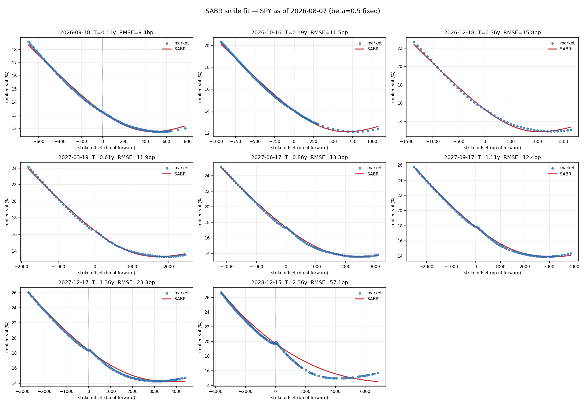
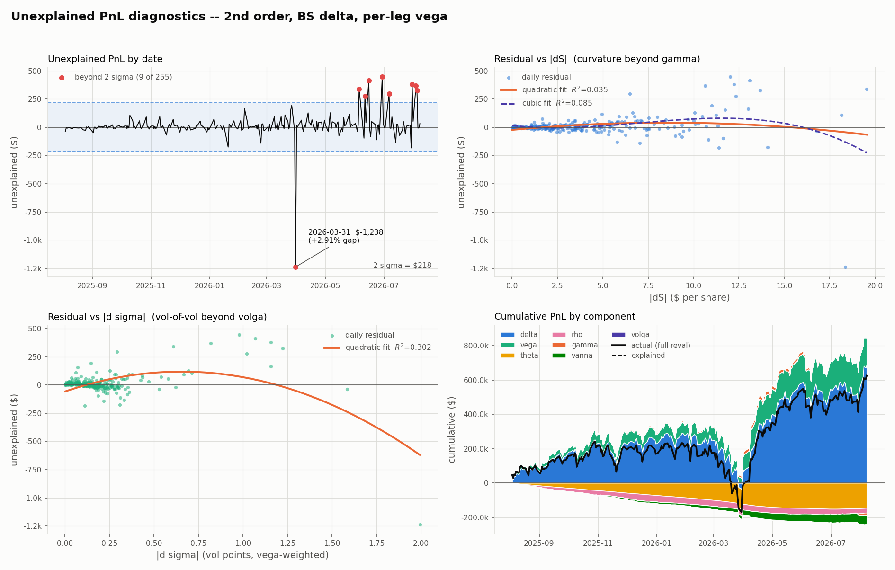
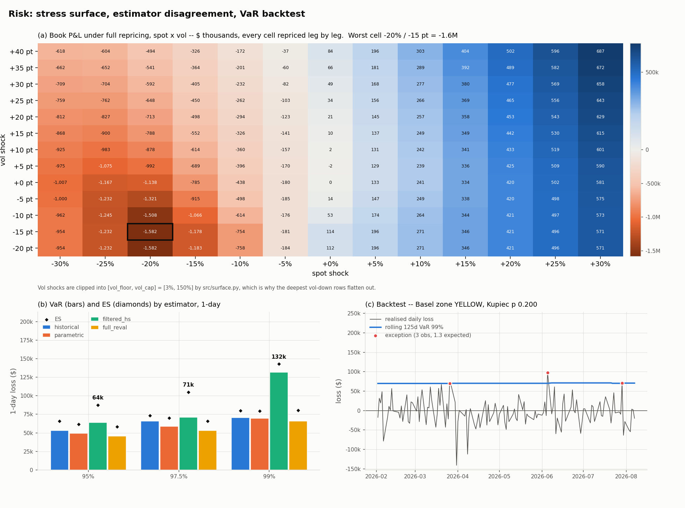

# Derivatives Pricing & Risk

**From market curves and volatility surfaces to portfolio valuation, Greeks, P&L attribution, and risk.**

## Overview

This repository builds an end-to-end derivatives valuation stack:

```text
market rates ------> SOFR curve -----------\
                                            > option pricing -> Greeks / P&L attribution -> portfolio risk
SPY option quotes -> SABR volatility surface /
```

It bootstraps a SOFR OIS curve from SR3 futures and OIS swaps, calibrates a SABR
surface to SPY implied volatilities, and uses the resulting market state to value
an eight-leg SPY option portfolio. The same leg-level pricing engine produces
portfolio Greeks, daily P&L attribution, full-revaluation VaR/ES, and stress
results. The curve and volatility modules produce calibrated market-state
inputs that converge in the portfolio valuation layer; attribution and risk then
reuse the same pricing machinery. The cached market snapshots make the reported
results reproducible.

## Pricing Framework

### 1. Curve construction

`curves/` builds a 40-year SOFR OIS curve from 7 SR3 futures and 14 OIS swaps.
The sequential bootstrap uses daily simple SOFR compounding on ACT/360,
Modified Following date adjustment, T+2 effective dates, and a two-business-day
payment lag. Its outputs include discount factors, zero rates, segment forwards,
par-rate checks, and bump-and-rebootstrap key-rate risk.

### 2. Volatility surface

`surface/` converts SPY option bid/ask mids to Black-76 implied volatilities and
calibrates Hagan SABR independently across eight expiries with beta fixed at
0.5. Forwards are inferred from put-call parity while discount factors are
pinned from the rate input. The calibrated surface is checked for butterfly and
calendar arbitrage before being passed downstream.



### 3. Option valuation and Greeks

`attribution/` maps the calibrated SABR term structure into a daily market
state and prices each European option leg with Black-Scholes. It calculates
standard and SABR-adjusted delta, gamma, vega, theta, rho, vanna, and volga.
Portfolio exposures are obtained by aggregating the eight priced legs; vega is
also measured by expiry bucket through bump-and-reprice.

### 4. Portfolio aggregation and repricing

The portfolio is valued leg by leg, then aggregated into book value and risk
sensitivities. The same portfolio pricer is reused by `risk/` as a revaluation
callback, so Greek approximations and full-repricing results are compared on a
consistent valuation basis.

## Key Results

| Stage | Verified result | Evidence |
|---|---|---|
| SOFR curve | **21 curve pillars** reproduce their input quotes to **4.91e-11 bp**, versus a **0.01 bp** tolerance | [`curves/output/par_rate_check.csv`](curves/output/par_rate_check.csv) |
| SABR surface | **735 SPY quotes across 8 expiries**; aggregate RMSE **24.4 bp** | [`surface/output/calibrated_params.csv`](surface/output/calibrated_params.csv) |
| Surface fit disclosure | RMSE is **14.8 bp** excluding the 2.36y expiry; that expiry fits poorly at **57.1 bp** and is retained rather than hidden | [`surface/README.md`](surface/README.md) |
| P&L attribution | Second-order Greeks reduce mean unexplained P&L from **$348 to $43** (**87.6%**), with **R² 0.99999** | [`attribution/output/attribution_summary.csv`](attribution/output/attribution_summary.csv) |
| Portfolio risk | 1-day 99% full-revaluation VaR **$65,588** and ES **$80,219** on a **$1.66M** book | [`risk/output/var_summary.csv`](risk/output/var_summary.csv) |

## Representative Portfolio Case

The central case is an eight-leg SPY option book containing calls and puts
across multiple strikes, expiries, and long/short positions. It connects every
stage of the repository:

1. Bootstrap discount factors and forward rates from the SOFR curve.
2. Calibrate the SPY SABR surface and assign each leg an implied volatility.
3. Price every leg and aggregate the portfolio value and Greeks.
4. Explain daily changes in book value with delta, gamma, vega, theta, rho,
   vanna, and volga.
5. Apply historical and hypothetical shocks through full leg-level repricing.
6. Aggregate the repriced loss distribution into VaR, ES, and stress results.

The 2026-08-07 snapshot has a portfolio value of **$1,662,294**. Its valuation,
exposures, attribution, and risk measures are therefore different views of the
same book rather than disconnected demonstrations.



## Pricing vs Approximation

The repository uses approximation as a benchmark against repricing, not as a
substitute for it.

- **First-order vs second-order attribution.** Adding gamma, vanna, and volga
  reduces mean unexplained daily P&L from $348 to $43, an 87.6% reduction.
- **Standard vs SABR delta.** Adding the smile response term to Black-Scholes
  delta reduces delta-hedged P&L volatility from **$5,454 to $3,311**, a 39.3%
  reduction.
- **Taylor vs full repricing at one-day shocks.** The delta-gamma-vega
  approximation stays within **6.0–10.4%** of full-revaluation VaR across the 95%, 97.5% and 99% levels;
  daily shocks are small enough for the local expansion to work well.
- **Taylor vs full repricing under stress.** Across eleven stress scenarios,
  the same expansion has a **32% median absolute error** and exceeds **100%** in two of them.
  The comparison locates the approximation's useful range: strong locally,
  materially less reliable at stress magnitudes.

## Risk & Validation

`risk/` treats the pricing engine as the foundation for downstream market-risk
analysis. It implements historical, parametric delta-gamma-vega, filtered
historical, and full-revaluation VaR/ES; historical and hypothetical stress
scenarios; a spot-vol grid; reverse stress; and Kupiec and Christoffersen
backtests.

The adverse results remain visible. Historical VaR fails the Kupiec test at 95%
and 97.5% as configured, while Christoffersen finds no exception clustering.
The FRTB profit-and-loss attribution variants pass, but risk-theoretical and
hypothetical P&L share the same surface, so that result is not an independent
validation. Governance and SR 11-7-aligned documentation are kept in the
downstream validation report rather than used as the project's primary identity.



Full methodology, qualifications, and remediation items:
[`docs/MODEL_VALIDATION.md`](docs/MODEL_VALIDATION.md).

## System Design / Dependency Chain

```text
curves/                         surface/
SR3 + OIS quotes                SPY option chains
      |                               |
      v                               v
SOFR bootstrap                  SABR calibration
      |                               |
      +-- curve.csv --------+         +-- calibrated_params.csv --+
                            |                                    |
                            v                                    v
                         attribution/  8-leg SPY book
                         valuation + Greeks + P&L attribution
                                      |
                                      +-- attribution files ------+
                                      +-- portfolio pricer -------+
                                                                   v
                                                                risk/
                                                        VaR / ES + stress
```

The four stages hand actual files to later stages:

- `curves/output/curve.csv` supplies rates to the valuation stage. The SABR
  calibration separately pins discount factors from its cached Treasury-rate
  inputs when converting option mids to implied volatilities.
- `surface/output/calibrated_params.csv` supplies the calibrated smile by expiry.
- `attribution/output/daily_attribution.csv` and exposure files supply the
  realized attribution history used by risk analysis.
- `risk/` imports the attribution portfolio pricer for consistent leg-level
  revaluation under historical and stress shocks.

## Repository Structure / Running

| Directory | Responsibility | Detail |
|---|---|---|
| `curves/` | SOFR OIS bootstrap, discount factors, forwards, swap pricing, key-rate DV01 | [`curves/README.md`](curves/README.md) |
| `surface/` | SPY implied-volatility construction, SABR calibration, arbitrage diagnostics | [`surface/README.md`](surface/README.md) |
| `attribution/` | Option valuation, Greeks, bucket vegas, daily P&L attribution, FRTB PLA | [`attribution/README.md`](attribution/README.md) |
| `risk/` | VaR/ES, full repricing, backtesting, stress and reverse stress | [`docs/MODEL_VALIDATION.md`](docs/MODEL_VALIDATION.md) |

Run the stages in dependency order:

```bash
cd curves && python run.py
cd ../surface && python run.py
cd ../attribution && python run.py
cd .. && python risk/run_risk.py

python attribution/tests/test_sanity.py
python surface/tests/test_sanity.py
```

Dependencies: `numpy`, `scipy`, `pandas`, `matplotlib`, and `yfinance`. Each
module reads its cached market-data snapshot by default; `--live` refreshes
market data and will produce different results.

## Limitations

- **Single-date market inputs.** The curve and SABR surface are calibrated to
  individual snapshots rather than a fully historical curve/surface dataset.
- **SABR specification.** Beta is fixed at 0.5, and the retained 2.36y expiry
  has a visibly weaker 57.1 bp fit.
- **Frozen smile dynamics.** Daily attribution evolves the ATM volatility level
  while holding SABR rho and nu fixed, so changing skew and vol-of-vol regimes
  are not represented.
- **Simplified volatility risk.** Risk scenarios apply a parallel volatility
  shift rather than a full term-structure or smile deformation.
- **Non-independent validation.** Repricing and Greek approximations reuse the
  same model and this validation was performed by the model developer.

Detailed module caveats, backtest qualifications, stress-floor effects, and
open validation items are documented in
[`docs/MODEL_VALIDATION.md`](docs/MODEL_VALIDATION.md).
