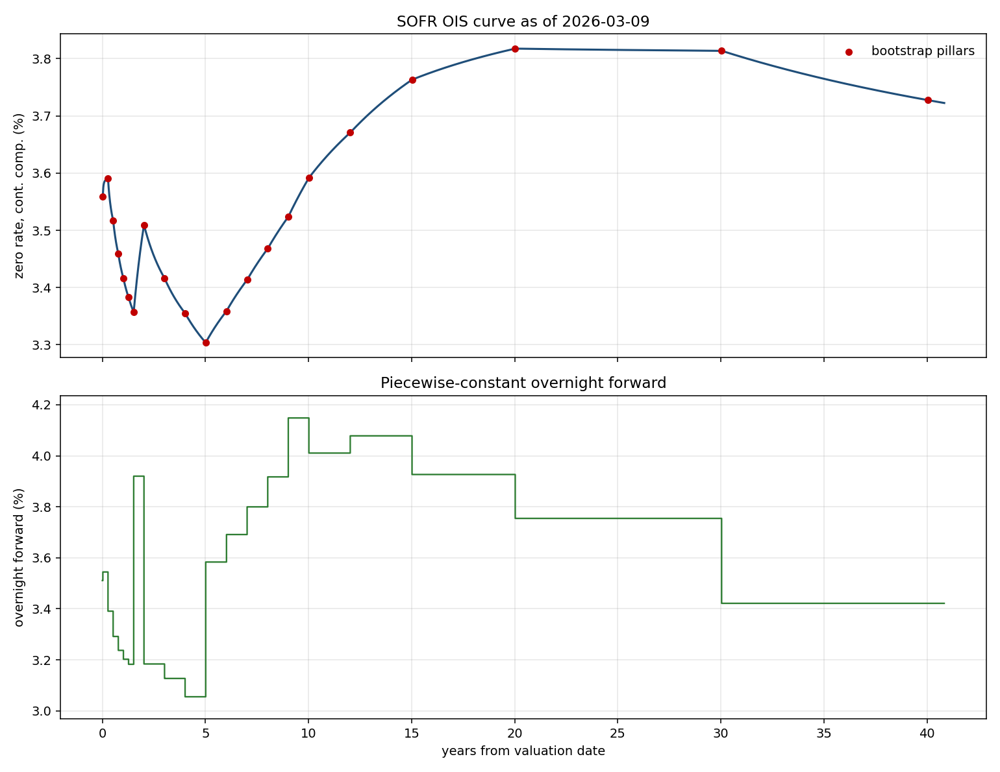
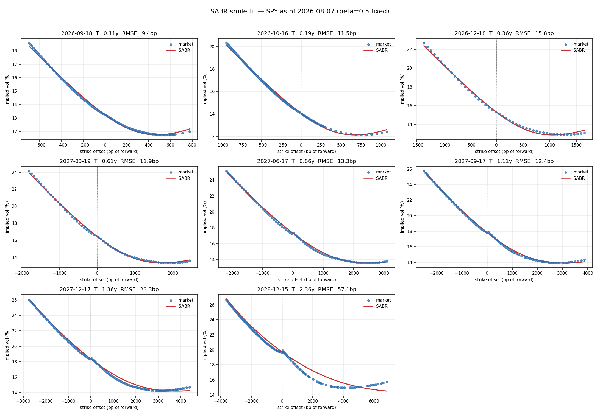
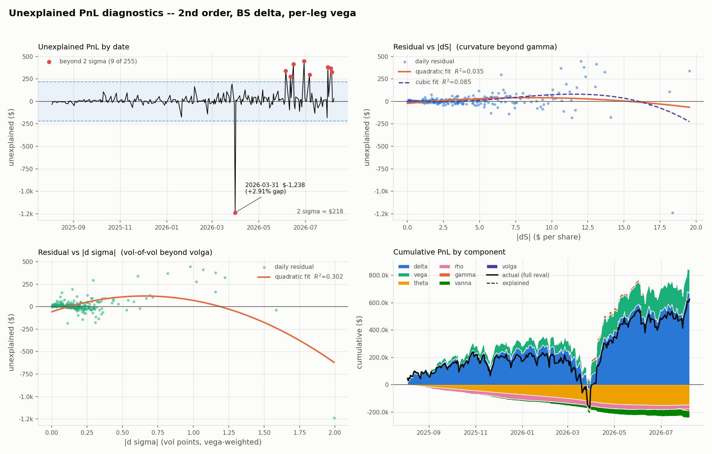

# Derivatives Pricing & Risk

**Problem.** Price an option book the way a desk has to: from traded quotes, under
real market conventions, with a risk number you can defend when the Greeks stop
being accurate.

**Approach.** Four stages, each consuming the previous stage's output *files* — no
mocks, no in-memory hand-offs. Bootstrap a 40-year SOFR OIS curve from futures and
swaps; calibrate SABR to a SPY vol surface; value an 8-leg book daily and decompose
its P&L into Greek contributions; then reprice that book under historical and
hypothetical shocks for VaR, ES and stress.

**Result.** 21 curve pillars reproduce their inputs to 4.91e-11 bp. 735 option
quotes fit at 24.4 bp aggregate RMSE with zero arbitrage violations. Second-order
Greeks cut mean unexplained P&L 87.6% ($348 → $43 against $22,031 mean daily P&L).
1-day 99% VaR by full revaluation is $65,588 on a $1.66M book — and the rolling
historical estimator that is supposed to approximate it **fails its Kupiec backtest**
(12 and 9 exceptions against 6.5 and 3.25 expected), which is reported rather than
retuned.

A full rerun from a clean clone reproduces every committed output byte for byte.

```
curves/              surface/            attribution/         risk/
7 SR3 futures        SPY chains          8-leg SPY book       4 VaR/ES estimators
+ 14 OIS swaps       735 quotes          255 daily moves      11 stress scenarios
     │                   │                    │                     │
     ▼                   ▼                    ▼                     ▼
bootstrap 40Y        calibrate SABR      Greek attribution    full repricing
piecewise-const      per expiry          + FRTB PLA test      + 13x13 grid
     │                   │                    │                     │
     └── curve.csv ─────►│                    │                     │
                         └─ calibrated_params►│                     │
                                              ├─ daily_attribution ►│
                                              └─ pricer (revalue) ──┘
```

---

## Results

### curves/ — SOFR OIS bootstrap and key-rate risk

| check | result | file |
|---|---|---|
| pillars | 7 SR3 futures + 14 OIS swaps = 21, spanning 40.04y | `output/curve.csv` |
| self-consistency | max reproduction error **4.91e-11 bp** vs 0.01 bp tolerance | `output/par_rate_check.csv` |
| held-out strip | 6 SR1 quotes excluded as pillars, repriced at **12.7 bp mean / 17.9 bp max** basis | `output/par_rate_check.csv` |
| sum of KR01 vs parallel DV01 | **0.005%–0.075%** across 7 benchmark swaps | `output/risk_ladder.csv` |



**The degenerate ladder is the finding, not a bug.** A $100mm 10Y par swap carries
$84,256 of parallel DV01 and **100%** of its gross key-rate exposure on the 10Y
pillar — bump any other input and the later swaps rebootstrap to hold their own par
rates, so the 10Y par rate cannot move. Off-pillar maturities are what produce a
hedgeable ladder: 11Y_par puts 54.4% on its largest pillar, 1Y_par 21.2%.

**Front-contract gearing.** 82 of SR3H26's 91 reference days are already fixed, so a
1 bp move in the quote must be absorbed by the remaining 9-day stub — a **10.03x**
gearing. On the 1Y benchmark it picks up **$1,947** of KR01 against $2,505 for the
full-quarter contract behind it, while spanning nine days of free curve instead of 91.

### surface/ — SABR calibration and static-arbitrage diagnostics

| expiry | T (y) | quotes | RMSE (bp) | ρ | ν |
|---|---|---|---|---|---|
| 2026-09-18 | 0.11 | 107 | 9.45 | −0.503 | 2.152 |
| 2026-10-16 | 0.19 | 105 | 11.52 | −0.548 | 1.772 |
| 2026-12-18 | 0.36 | 48 | 15.85 | −0.577 | 1.334 |
| 2027-03-19 | 0.61 | 67 | 11.88 | −0.612 | 0.978 |
| 2027-06-17 | 0.86 | 84 | 13.30 | −0.639 | 0.776 |
| 2027-09-17 | 1.11 | 96 | 12.45 | −0.633 | 0.667 |
| 2027-12-17 | 1.36 | 112 | 23.27 | −0.627 | 0.572 |
| 2028-12-15 | 2.36 | 116 | **57.13** | −0.617 | 0.319 |
| **all** | | **735** | **24.37** (14.58 excl. 2.36y) | | |



| diagnostic | result |
|---|---|
| butterfly, ±6000 bp grid | 0 negative density points |
| butterfly, ±9000 bp stress grid | 0 negative |
| butterfly, 400k-point log grid to K/F = 1e-3 | 0 negative, 0 of 8 expiries |
| calendar (10 log-moneyness × 7 expiry pairs) | 0 of 70 violated |
| ATM reproduction (α from the ATM cubic) | max 1.1e-12 bp |

The deep-wing probe exists because a symmetric bp grid bottoms out at 0.10·F and
structurally cannot reach SABR's known low-strike failure. The detector is
positive-controlled: `tests/test_sanity.py` forces ν = 2.0 and a 10y rates case and
confirms it fires.

**ρ is not monotone** — it turns at T = 0.86y. Reported, not smoothed. β is fixed at
0.5, near-degenerate with ρ.

### attribution/ — Greek P&L explain on an 8-leg book

255 daily moves, 2025-08-01 → 2026-08-07, spot +24.4%, 5 days beyond |2%|, mean
|daily P&L| $22,031.

| variant | mean \|unexplained\| | % of \|P&L\| | R² |
|---|---|---|---|
| 1st order (δ, vega, θ, ρ) | $348 | 1.58% | 0.99923 |
| **+ gamma, vanna, volga** | **$43** | **0.196%** | **0.999986** |
| single vol number, 2nd order | $3,795 | 17.2% | 0.9461 |
| bucketed vega, 2nd order | $2,965 | 13.5% | 0.9665 |

Second-order terms cut the residual **87.6%**. Vega granularity matters far more
than Greek order: one vol number leaves $3,795, a 4-bucket ladder $2,965 (−21.9%,
stable across κ = 2/4/8), per-leg vol $43.



**Deltas disagree about which test they win.**

| delta | attribution residual | delta-hedged P&L std |
|---|---|---|
| Black–Scholes | **$43** | $5,454 |
| SABR | $152 | **$3,311 (−39.3%)** |
| Bartlett | $328 | $6,943 (+27.3%) |

SABR delta makes the attribution *worse* and the hedge *better* — the attribution
absorbs a bad delta into its vega term, a hedge cannot. Bartlett's delta assumes a
leverage effect the symmetric EWMA surface does not have; supplying one (GJR)
improves its hedge std 17.7% (6,943 → 5,716), which is the predicted direction.

FRTB PLA: **11 of 11 variants pass** (2nd-order variance ratio 0.0013% vs the 20%
limit, mean ratio 0.05%). That pass is close to guaranteed by construction —
risk-theoretical and hypothetical P&L come from the same surface — and is reported
as a mechanism check, not a validation.

### risk/ — VaR, ES, backtest, stress

Snapshot 2026-08-07, book value $1,662,294. `revalue(0,0,0) = 0` exactly; 64,865
repricing calls per run.

| 1-day estimator | 95% | 97.5% | 99% | 99% ES |
|---|---|---|---|---|
| historical | 53,279 | 65,709 | 70,650 | 79,784 |
| parametric (δ-Γ-vega) | 49,135 | 58,548 | 69,492 | 79,615 |
| filtered HS (λ 0.94) | 64,054 | 71,016 | **131,686** | 142,883 |
| **full revaluation** | 45,545 | 53,033 | **65,588** | **80,219** |


**Two adverse results.**

1. **The rolling 125-day historical VaR fails Kupiec** at 95% (12 exceptions vs
   6.50 expected, p = 0.047) and 97.5% (9 vs 3.25, p = 0.008) — Basel red at both.
   Christoffersen finds no clustering (p = 0.90 / 1.00), so the failure is level,
   not timing. Six tests are run across the three confidence levels: Holm-adjusted,
   the 97.5% rejection survives (p = 0.046) and the 95% one does not (p = 0.233),
   so the conclusion rests on the 97.5% result and on the exception counts, which
   no adjustment touches. The tested sample is 130 days, below the 250-day Basel
   window, so the count test has low power either way. That estimator is not fit
   for limit-setting at those levels as configured.
2. **The expected "material gap" between Taylor and repricing did not appear at
   1-day sizes** — largest parametric vs full-reval gap is −9.4%. The same
   expansion misses by a **median 32.2%** and up to **89.2%** at stress sizes, and
   flips sign on one scenario. Small gap at VaR sizes and large gap under stress is
   one finding, not two contradictory ones.

| stress (full repricing) | P&L | % of book | Taylor error |
|---|---|---|---|
| 2022 rates repricing (−25%, +15 pt, +400 bp) | −$785,466 | −47.3% | −41.5% |
| Lehman / GFC (−30%, +45 pt, −150 bp) | −$607,146 | −36.5% | −78.3% |
| COVID crash (−34%, +60 pt, −150 bp) | −$484,394 | −29.1% | −89.2% |
| Spot −10%, vol unchanged | −$437,670 | −26.3% | +3.3% |
| Aug 2024 carry unwind (−3%, +38 pt) | −$1,268 | −0.1% | sign flip |

Worst cell of the 13×13 spot×vol grid is **−$1,582,048 (−95.2% of book) at spot
−20% / vol −15 pts — interior, not a corner.** A corner-only scenario set misses it.
Reverse stress: −$100k needs a −3.3% spot move; −$1mm needs −16.0% and −5.25 vol pts.

---

## Running it

Order matters — each stage reads the previous stage's files.

```bash
pip install -r requirements.txt
cd curves && python3 run.py            # 3s
cd ../surface && python3 run.py        # 5s
cd ../attribution && python3 run.py    # 40s
cd .. && python3 risk/run_risk.py      # 74s
python3 -m pytest -q                   # 65 checks: 63 invariants + 2 cross-module
cd surface && python3 tools/smile_roughness.py   # re-derives the expiry exclusions
```

Every module caches its market-data pull, so a rerun reproduces the numbers above
exactly; `--live` re-pulls from yfinance and will differ. Verified: a full rerun in
a fresh clone left `git status` clean, PNGs included.

| path | contents |
|---|---|
| `curves/` | bootstrap, swap pricing, key-rate DV01 by bump-and-rebootstrap |
| `surface/` | SABR calibration, butterfly / calendar / deep-wing diagnostics |
| `attribution/` | 8-leg book, Greek attribution, FRTB PLA, delta and vega experiments |
| `risk/` | 4 VaR/ES estimators, Kupiec + Christoffersen, stress grid, reverse stress |
| `docs/MODEL_VALIDATION.md` | SR 11-7-structured validation report |

---

## Limitations

Each is a known, quantified, uncorrected choice — not residual uncertainty.

**Curve.** Convexity set to 0.0 bp (a real bias inside 2Y, exposed as a config knob).
The 6 SR1 quotes are not reproduced: every SR1 month sits inside an SR3 quarter, so
forcing both strips onto the pillars pins the redundancy onto residual stubs
(adjacent forwards of 1.83% and 4.40%). Single valuation date, so nothing downstream
has curve history.

**Surface.** Single calibration date. The 2.36y expiry does not fit (57.1 bp vs
9.4–23.3 bp). Of 10 expiries in the raw snapshot, 8 are calibrated, and
`surface/tools/smile_roughness.py` re-derives both exclusions: 2028-06-16 is
dropped for quote quality (RMS IV second difference 0.4275 vol pts, 5.9x the
roughest expiry that is kept), while 2026-08-21 is dropped for scope and not for
quality — it is the cleanest smile in the file, but the downstream book's shortest
leg reaches T = 0.114990y, exactly the first calibrated pillar, so a 14-day pillar
is never interpolated. Calibrating it anyway fits at 6.59 bp with every arbitrage
check still at zero. β fixed at 0.5.

**Attribution.** ρ and ν are frozen through time; only the ATM level is evolved,
scaled by EWMA realised vol. The surface therefore cannot represent skew steepening
in a selloff. The calibration date is the *last* day of the P&L window, so the
surface shape is applied backwards over the prior year — the attribution itself is
an identity under that surface, but the vol path is a deterministic function of the
spot path, so vega and vanna contributions are partly mechanical. Bucket-vega
additivity is exact by construction (each leg sits in one bucket), not as a finding.

**Risk.** One vol risk factor — a parallel level shift — is the binding limitation:
bucket vegas largely cancel (on 2026-04-07: 0 / +30,085 / −41,536 / +32,499 per
point against a parallel +21,049), so VaR and stress are downward-biased for any
term-structure twist. √t scaling needs iid returns and a locally linear book; this
book's gamma changes sign 19 times. Shocked vols are clipped at a 3% floor and the
worst grid cell sits on that floor, so it is a lower bound. The P&L series being
backtested is model-generated, not traded, and full revaluation shares its pricer
with the approximations it benchmarks — it bounds Taylor error, not pricing-model
error. This is a self-validation and does not meet SR 11-7 independence.

Not a production risk system. Open items are tracked in `docs/MODEL_VALIDATION.md` §7.
